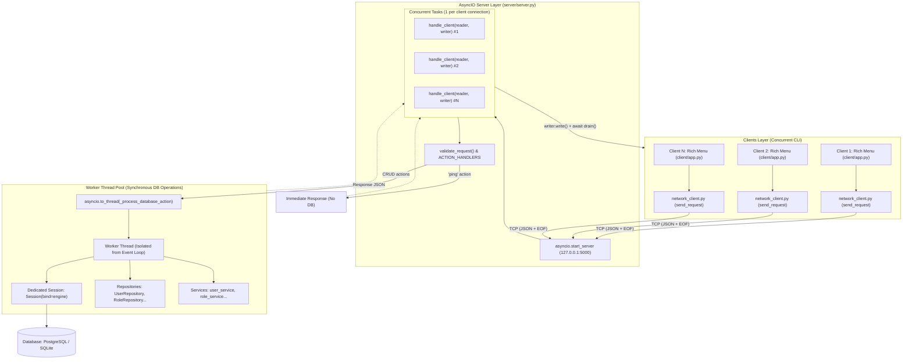

# PixelHub

PixelHub is a back-office application that performs CRUD operations for
users, roles, profiles, posts, categories, and tags.

The application uses two programs:

- A secure asynchronous TCP server that manages concurrent clients, authenticates them via X.509 certificates, encrypts communications with AES-GCM, and coordinates with the database.
- A command-line client that communicates securely with the server.

## Architecture Diagram



## Requirements

- Python 3.10 or newer.
- A database supported by the SQLAlchemy configuration.

## Installation

Create and activate a virtual environment:

```bash
python -m venv venv
```

On Windows:

```powershell
.\venv\Scripts\Activate.ps1
```

Install the dependencies declared in `pyproject.toml`:

```bash
python -m pip install -e .
```

Configure the database connection using the environment settings expected by
`server/domain/config.py`.

## Running the application

Start the server first:

```bash
python server/server.py
```

Then open a second terminal and start the client:

```bash
python client/app.py
```

The default server address is `127.0.0.1:5000`. Both programs define their
TCP settings directly at the top of their own files (`server/server.py` and
`client/network_client.py`).

## Communication protocol

The client and server exchange UTF-8 encoded JSON through non-blocking TCP
sockets managed by Python's `asyncio` framework. The server supports multiple
simultaneous client connections, offloading synchronous database queries to
worker threads (`asyncio.to_thread`) to ensure the event loop remains responsive.

A request contains an action in `accion` and its input values in `datos`:

```json
{
  "accion": "get_user",
  "datos": {
    "id": 1
  }
}
```

A successful response contains `status`, `message`, and `data`:

```json
{
  "status": "ok",
  "message": "User retrieved successfully.",
  "data": {
    "id": 1,
    "username": "student",
    "email": "student@example.com",
    "role_id": 2
  }
}
```

Errors use the same structure with `status` set to `error` and `data` set to
`null`:

```json
{
  "status": "error",
  "message": "The field 'id' must be an integer.",
  "data": null
}
```

See [PROTOCOL.md](PROTOCOL.md) for all supported actions and required fields.

## Security and Cryptography (Practice 3)

PixelHub implements a hybrid cryptographic architecture based on the UVic Python Cryptography module:

1. **Client Authentication:** Before application requests are accepted, the client presents an X.509 certificate. The server verifies the certificate's validity and digital signature against a trusted Root CA (`certs/ca_cert.pem`).
2. **Session Key Establishment:** The server generates a random 256-bit AES session key and encrypts it using the client's public key with **RSA-OAEP** (SHA-256). The client decrypts this session key using its private key.
3. **Confidentiality & Integrity:** All application request and response bodies are encrypted using **AES-256-GCM** with a fresh 12-byte nonce per message. Any tampering with the ciphertext causes decryption to fail.
4. **Certificate Management:** Certificates can be inspected or generated using:
   ```bash
   python scripts/generate_certs.py
   ```

For an in-depth architectural breakdown and sequence diagrams, see [docs/practice3_cryptography_architecture.md](docs/practice3_cryptography_architecture.md).

## Tests

The test suite covers protocol serialization, request validation, routing,
services, and asynchronous concurrency (including multiple simultaneous clients
and non-blocking database queries). Run them from the project directory:

```bash
python -m pytest tests
```
