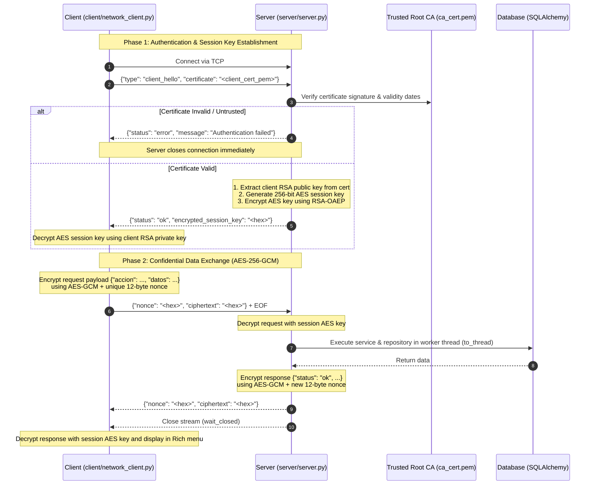

# PixelHub Practice 3: Cryptographic Architecture & Client Authentication

## 1. Context and Objective

In **Practice 2**, PixelHub was upgraded to an asynchronous architecture using Python's `asyncio` framework. While this provided non-blocking concurrent communication for multiple simultaneous clients, it had two critical security limitations:

1. **Lack of Authentication:** Any client could connect to TCP port 5000 and execute arbitrary CRUD actions against the database.
2. **Lack of Confidentiality:** All JSON payloads traveled over the network in plaintext UTF-8, allowing eavesdroppers to intercept sensitive data (passwords, emails, user profiles).

**Practice 3** addresses these vulnerabilities by implementing a **hybrid cryptographic architecture** using Python's `cryptography` library.

### Core Goals:
- **Client Authentication:** Authenticate clients using X.509 public-key certificates signed by a trusted Certification Authority (CA).
- **Session Key Establishment:** Securely exchange a temporary symmetric AES session key using asymmetric **RSA-OAEP**.
- **Confidentiality and Integrity:** Protect all application data exchanges using **AES-256-GCM** with a fresh 12-byte nonce per message.
- **Protection Against Unauthorized Access:** Immediately reject clients with missing, untrusted, or forged certificates.

---

## 2. Cryptographic Architecture Diagram



---

## 3. Public Key Infrastructure (PKI) Components

All cryptographic keys and certificates are stored in the `certs/` directory and can be generated with `scripts/generate_certs.py`:

| File | Type | Description |
| :--- | :--- | :--- |
| `ca_cert.pem` | X.509 Root Certificate | Self-signed trust anchor (`CN=PixelHub Root CA`). Used by the server to validate client certificates. |
| `ca_key.pem` | RSA 2048 Private Key | Private key used solely to sign valid server and client certificates. |
| `server_cert.pem` | X.509 Server Certificate | Identifies the server (`CN=PixelHub Server`), signed by the CA. |
| `server_key.pem` | RSA 2048 Private Key | Server private key. |
| `client1_cert.pem` | X.509 Client Certificate | Certificate identifying client 1 (`CN=client1`), signed by the CA. |
| `client1_key.pem` | RSA 2048 Private Key | Private key of client 1 (used to decrypt the AES session key). |
| `client2_cert.pem` | X.509 Client Certificate | Certificate identifying client 2 (`CN=client2`), signed by the CA. |
| `client2_key.pem` | RSA 2048 Private Key | Private key of client 2. |

---

## 4. Cryptographic Primitives Implementation

The implementation strictly follows the cryptographic concepts covered in the course syllabus:

### A. Asymmetric Encryption: RSA-OAEP (Slides 18-19)
- **Algorithm:** RSA with Optimal Asymmetric Encryption Padding (OAEP).
- **Parameters:** Mask Generation Function MGF1 with SHA-256, hash algorithm SHA-256.
- **Function:** `encrypt_session_key(public_key, aes_key)` and `decrypt_session_key(private_key, encrypted_key)`.
- **Why RSA-OAEP?:** Standard textbook RSA is vulnerable to mathematical attacks. OAEP introduces randomized padding, ensuring identical plaintexts yield completely different ciphertexts and protecting against chosen-ciphertext attacks.

### B. Authenticated Symmetric Encryption: AES-GCM (Slides 11-13)
- **Algorithm:** Advanced Encryption Standard in Galois/Counter Mode (AES-GCM).
- **Key Length:** 256 bits (`AESGCM.generate_key(bit_length=256)`).
- **Nonce:** Unique 12-byte (96-bit) cryptographically secure random nonce (`os.urandom(12)`) per encryption.
- **Why AES-GCM?:** Unlike basic block modes (such as CBC), GCM is an **AEAD** (Authenticated Encryption with Associated Data) mode. It provides both:
  1. **Confidentiality:** Data cannot be read by third parties.
  2. **Integrity / Authenticity:** An authentication tag is produced. If an attacker modifies even a single bit of the ciphertext during transit, decryption fails with an `InvalidTag` exception.

### C. Digital Signatures and Certificate Validation (Slides 23-26)
- **Signature verification:**
  ```python
  ca_public_key.verify(
      cert.signature,
      cert.tbs_certificate_bytes,
      padding.PKCS1v15(),
      cert.signature_hash_algorithm,
  )
  ```
- The server checks:
  1. Validity period (`not_valid_before_utc <= now <= not_valid_after_utc`).
  2. Issuer matches the trusted CA's subject name.
  3. The cryptographic signature matches the CA's public key.

---

## 5. Security Properties and Threat Mitigation

| Threat | Vulnerability in Practice 2 | Mitigation in Practice 3 |
| :--- | :--- | :--- |
| **Unauthorized Client Access** | Any client could send arbitrary CRUD actions. | Server rejects connections unless the client presents a valid X.509 certificate signed by `PixelHub Root CA`. |
| **Eavesdropping (Sniffing)** | Passwords and records sent in plaintext JSON. | Application payloads are encrypted with AES-256-GCM. An eavesdropper sees only random hex bytes. |
| **Man-in-the-Middle (Tampering)** | An attacker could modify IDs or payload values. | AES-GCM authentication tag verification fails if any ciphertext byte is altered. |
| **Replay / Nonce Reuse** | Reusing a key/nonce pair breaks GCM confidentiality. | A fresh, random 12-byte nonce is generated for every single message. |
| **Brute Force on Plaintext** | Small RSA messages without padding are crackable. | Session key exchange uses RSA-OAEP with SHA-256. |

---

## 6. How to Run and Test

### 1. Generating Certificates
To generate or inspect certificates:
```bash
python scripts/generate_certs.py
```
*(Certificates are also automatically created if missing when the server or client starts).*

### 2. Running the Server and Client
Start the server in one terminal:
```bash
python server/server.py
```
Start the client in another terminal:
```bash
python client/app.py
```

### 3. Switching Client Identities
By default, the client uses `client1`. To switch to `client2`, set the environment variable:
```powershell
$env:PIXELHUB_CLIENT="client2"
python client/app.py
```
Or call `network_client.set_client_identity("client2")` programmatically.

### 4. Running the Automated Test Suite
The tests cover positive and negative cryptographic scenarios (unauthenticated access, invalid certificates, concurrency, and tampering):
```bash
python -m pytest tests
```
Result: **47 passed in ~3.2s**.
